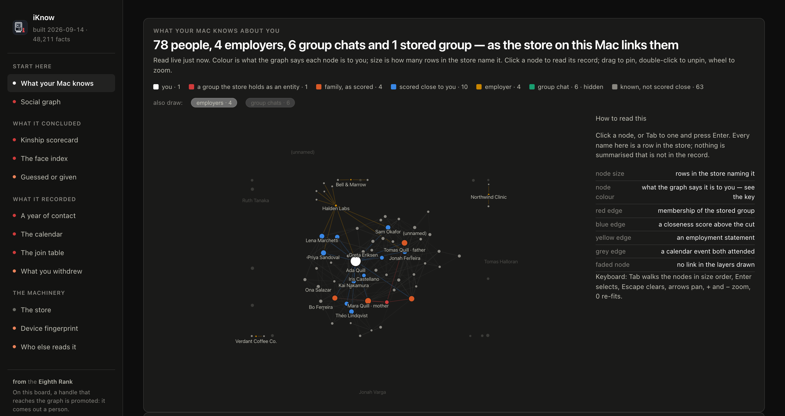

<p align="center">
  
</p>

<h1 align="center">iKnow</h1>

<p align="center">See what your Mac knows about you.</p>

macOS builds a knowledge graph about the person who uses it: who you know, how
it decided those people are related to you, who you write to and how often,
whose faces recur in your photos, where you will be next. The graph is part of
the Apple Intelligence bundle: the IntelligencePlatform store that the rest of
the system, Siri included, reads for personal context. It lives on disk under
your login, and macOS ships no way to look at it. Check out the [write up](https://8rank.ai/game/apple-intelligence-personal-knowledge-graph).

Apple documents very little of this. The daemon that builds the graph gets a
one-line man page, and there is no user-facing account of what it stores or
what it infers. iKnow is a look under the hood: a small web app that opens the
graph on your own Mac and shows you what is in it, what was recorded, what was
inferred, and which other parts of the system read it.

<p align="center">
  
</p>
<p align="center"><sub>The first screen, rendered from made-up data. No name, number or count in it is real.</sub></p>

## How it works

Everything stays on your machine.

- **One process, no dependencies.** `server.py` is a Python standard-library
  server. No Flask, no npm, no build step, nothing to install beyond Python 3.
- **Loopback only.** It binds `127.0.0.1`, and there is no flag to change that.
  The page fetches from that process and nowhere else; a Content-Security-Policy
  blocks anything off-machine.
- **A token at the door.** Each start prints a link carrying a random token, and
  the page and every endpoint refuse a request without it. Loopback keeps other
  machines out; the token keeps out other programs and other accounts on this
  Mac, and web pages open in your browser, all of which can reach `127.0.0.1`.
  It is not a sandbox: a program running as you, with access to your terminal
  or your browser history, could still find it.
- **Read-only.** Every database handle is opened `mode=ro`. Nothing on your Mac
  is changed.
- **Nothing written, nothing logged.** Values travel from the stores, over
  loopback, into your browser tab, and are never persisted.
- **The source carries no data.** Every name and number on screen is queried
  from your stores when the page loads. The code carries the queries; your Mac
  carries the answers.

It reads the live stores where macOS keeps them: the graph in
`~/Library/IntelligencePlatform`, the ontology inside the system's
IntelligencePlatformCore framework, and the four sources the graph resolves
against, which are Messages, Photos, Calendar and Contacts. Nothing is
extracted or copied first.

## Install and run

iKnow has only been tested on these macOS releases:

- macOS 26.6.2
- macOS 26.7.1
- macOS 27.0.1

Apple changes these stores between macOS releases, so on another version some
pages may come out incomplete. On macOS 27 and later, not every page may work
fully yet. When a page cannot read something, it says so under its title.

```sh
git clone https://github.com/8rank/iKnow.git
cd iKnow
python3 server.py
```

Then open the link it prints. `ctrl-c` stops it.

```text
  open this link to read the store:

  http://127.0.0.1:8765/?token=…
```

The token is new each time the server starts, and it is stored nowhere. Open
the link once: the browser swaps the token for a cookie, drops it from the
address bar, and reloads and new tabs work from then on, until the server
stops. If the page says **Open the link from the terminal**, it was reached
without the token, or the server has been restarted since the tab was opened.
Take the current link from the terminal.

### Giving it permission

The stores are protected by macOS privacy controls, so the terminal you start
the server from needs **Full Disk Access**:

1. Open **System Settings → Privacy & Security → Full Disk Access**.
2. Add the app you run the command from: Terminal, iTerm, or your editor.
3. Quit that app completely and open it again. The permission is picked up at
   launch, not while it is running.

On startup the server checks each store and prints `ok` or `DENY` beside it,
followed by these instructions, so a missing permission is obvious rather than
a bare SQLite error.

Full Disk Access is what lets the terminal read the files. It gives iKnow no
way to change them; every handle is read-only.

### Reading a copy instead

```sh
python3 server.py --port 9000                    # another port
python3 server.py --bundle /path/to/extracted    # an extracted copy, not this Mac
```

## Asking an agent

[MANUAL_FOR_YOUR_AGENT.md](MANUAL_FOR_YOUR_AGENT.md) is written for an AI agent
with a shell on your Mac, such as Claude Code or Codex. It covers where each
store is, how to open it read-only, what the tables and codes mean, how to join
out to Contacts, Photos, Calendar and Messages, and which columns mislead. Give
the agent the file and ask in plain language:

```text
Read MANUAL_FOR_YOUR_AGENT.md, then tell me who my Mac thinks my family is, and why.
```

The agent needs the same Full Disk Access as the server. Unlike the server, it
sends what it reads to wherever its model runs. So the manual makes it ask you,
before it reads anything, whether you trust that provider with your graph, and
then read only what each question needs.

## License

Apache 2.0. See [LICENSE](LICENSE).

---

<p align="center"><sub>iKnow is fully LLM-generated and may not be 100% accurate. If something should be updated, <a href="https://github.com/8rank/iKnow/issues">open an issue</a>.</sub></p>

<p align="center"><sub>From <a href="https://8rank.ai">the Eighth Rank</a>.</sub></p>
